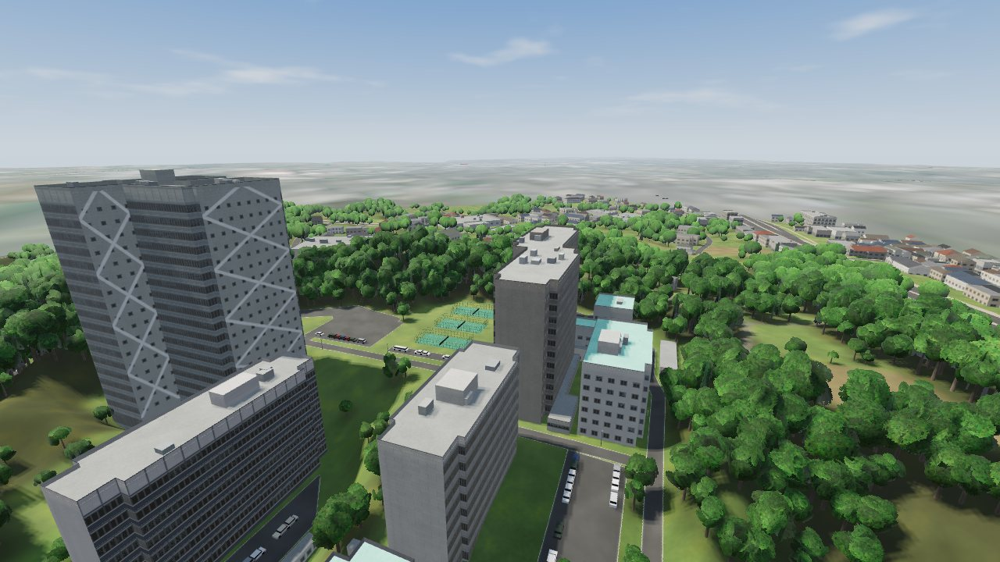
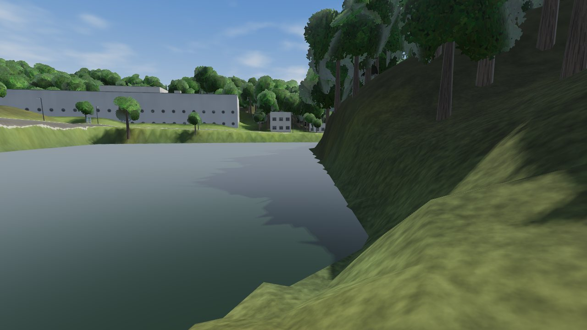
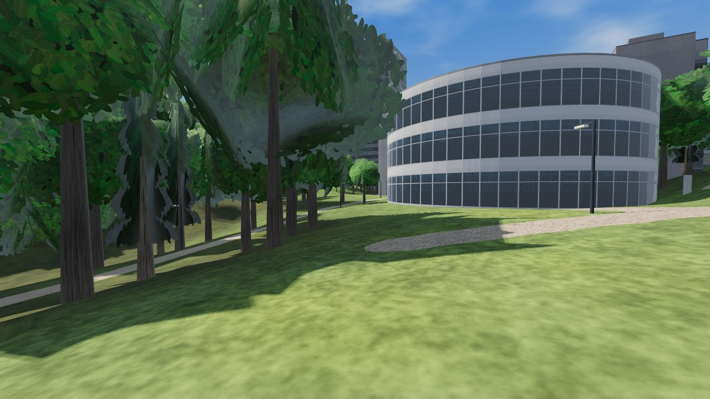

# 横浜キャンパス ウォーキングシミュレータ

東京科学大学 横浜キャンパス (2026 年 4 月に改称。旧 東京工業大学 すずかけ台キャンパス) を、
**公開データだけをもとに** 3D で再現し、一人称視点 (FPS 操作) で歩き回れるブラウザアプリです。

> 個人が公開データから制作した **非公式** の作品です。東京科学大学とは関係がありません。
> 建物の外観や小物は公開資料を参考にした推定で、実際と異なる部分があります。

**[ブラウザでキャンパスを歩く (GitHub Pages)](https://ks250206.github.io/campus-walking-sim/)**



| 池と S3 棟 (図書館)                  | H1 棟 (大学会館)           |
| ------------------------------------ | -------------------------- |
|  |  |

(上の画像は GPU の無い環境でソフトウェア描画したものです)

## 何が再現されているか

| 要素                                   | もとにしたデータ                                          | 再現の方法                                                                                                                           |
| -------------------------------------- | --------------------------------------------------------- | ------------------------------------------------------------------------------------------------------------------------------------ |
| 建物の外形と高さ                       | 国土交通省 **Project PLATEAU** の 3D 都市モデル (LOD1)    | 外形を実測の高さ (J2・J3 棟は 84.7 m など) まで立ち上げる。約 900 棟                                                                 |
| 棟名・道路・歩道・階段・池・門・駐車場 | **OpenStreetMap**                                         | 地面に道路・歩道・白線を描き分け、橋は高架として立体で作る                                                                           |
| 丘陵の起伏                             | **国土地理院** 標高タイル (航空レーザ測量の 5 m メッシュ) | 2 m 間隔の地形メッシュ。坂や谷はそのまま歩ける                                                                                       |
| 樹木 (約 1 万本)                       | **国土地理院** 全国最新写真 (シームレス)                  | 空中写真の色から樹冠を判定し、その位置に木を生やす                                                                                   |
| 遠景 (半径 2.6 km)                     | 国土地理院 標高タイル・空中写真                           | 粗い地形に写真の平均色を載せる                                                                                                       |
| 各棟の外観                             | 大学が公開している案内図・写真など                        | 外壁の色、連窓・丸窓、ルーバー付きバルコニー、J2・J3 棟の X 字ブレースなどを棟ごとに設定                                             |
| 地図に無い通路                         | 大学のバリアフリーマップ・写真                            | H1–H2 棟の 3 階ブリッジ (下を通り抜け)、加藤山の歩行者トンネル、階段、G2・G4 棟 1 階の通り抜けを、建物外形と標高から位置を決めて補う |
| 階数と主な施設                         | 大学のアクセシビリティマップ (各地区の建物情報)           | 各棟の地上階数 (G2 棟 11 階、J2・J3 棟 20 階など) に窓の段数を合わせ、現在地の表示に階数と施設 (食堂・図書館など) を添える           |

そのほか、すずかけ門、国道 246 号の高架、棟名サイン (地区ごとの色分け)、街灯、テニスコート、
駐車車両、送電鉄塔などを配置しています。窓の奥には部屋の中が見え (インテリアマッピング)、
時刻を夕方にすると窓明かりと街灯が灯ります。

## 動かし方

Node.js 26 と pnpm 12 が必要です。ツールチェーンは [Vite+](https://viteplus.dev/) (`vp`) です。

```bash
pnpm install
pnpm dev        # 開発サーバ (vp dev)
pnpm build      # 型チェック + 本番ビルド (dist/)
pnpm preview    # ビルドしたものを確認
pnpm check      # フォーマット・lint・型チェック (vp check)
```

WebGL 2 に対応した PC・スマートフォンのブラウザで開いてください。

## 公開 (GitHub Pages)

`main` に push すると、GitHub Actions ([`.github/workflows/deploy-pages.yml`](.github/workflows/deploy-pages.yml)) が
チェックとビルドを行い、`dist/` を GitHub Pages に公開します。

初回だけ、リポジトリの **Settings → Pages → Build and deployment → Source** を **GitHub Actions** にしてください。
公開先は [GitHub Pages](https://ks250206.github.io/campus-walking-sim/) です。

## 操作

### スマートフォン

「キャンパスを歩く」をタップし、左下のスティックで移動します。画面をドラッグすると視点を動かせます。

| 画面の操作                 | 動作                                              |
| -------------------------- | ------------------------------------------------- |
| 「走る」「ジャンプ」を押す | 走る / ジャンプ                                   |
| 「飛行」をタップ           | 飛行モードを切り替える (「上昇」「下降」は長押し) |
| 「地図」をタップ           | 全体図 / ファストトラベル                         |
| 「メニュー」をタップ       | 一時停止 (メニューから再開や入口への移動が可能)   |

### PC

| キー                       | 動作                                |
| -------------------------- | ----------------------------------- |
| `W` `A` `S` `D` / 矢印キー | 移動                                |
| マウス                     | 視点                                |
| `Shift`                    | 走る                                |
| `Space`                    | ジャンプ                            |
| `M`                        | 全体図 / ファストトラベル           |
| `F`                        | 飛行モード (`E` / `Q` で上昇・下降) |
| `R`                        | 入口 (すずかけ門) に戻る            |
| `Esc`                      | メニュー                            |

### 建物へのファストトラベル

PCでは `M`、スマートフォンでは「地図」で全体図を開きます。「行き先の建物」から棟を選ぶと、青い丸で到着地点を確認できます。「ファストトラベル」を押すと、建物の近くの歩道や構内道路に移動します。

## 設定

メニューの「設定」から変更でき、ブラウザに保存されます。

- **解像度** — ネイティブ / 4K / WQHD / フル HD / 1600×900 / HD / 960×540 (縦のピクセル数を指定し、横は画面の縦横比に合わせます)
- **視野角 (FOV)** — 垂直 40°〜110°
- **視点操作の感度** — 0.1〜4.0、上下反転
- 影の品質、見通し (霞)、時刻、視点の揺れ、ミニマップ、FPS 表示、SSAO

## 技術構成

- **描画**: [PixiJS](https://pixijs.com/) v8 + 公式の 3D 拡張 [`@pixi/3d`](https://pixijs.com/3d) (WebGL 2)
  - 地面・外壁・空・葉はすべて手続き的なシェーダ (`ShaderBit`) で、画像素材は使っていません
  - カスケードシャドウ、ACES トーンマッピング、指数フォグ
- **UI**: React 19 + Tailwind CSS 4
- **ビルド**: Vite+ (Vite 8 / Rolldown / Oxlint / Oxfmt)、TypeScript 7、pnpm 12、Node.js 26

```
scripts/
  fetch-sources.mjs   公開データを data/raw/ にダウンロード
  build-data.mjs      public/data/ のファイル (建物・道路・標高・樹木) を生成
src/sim/              3D の世界 (地形・建物・植生・小物・空・プレイヤー)
src/ui/               メニュー・設定・HUD・ミニマップ
public/data/          生成済みのデータ (リポジトリに含めてあります)
```

### データを作り直す

`public/data/` には生成済みのデータが入っているので、通常は不要です。
元データから作り直す場合は次のとおりです (ダウンロードは約 70 MB)。

```bash
pnpm data:fetch   # OpenStreetMap / PLATEAU / 地理院タイルを data/raw/ に取得
pnpm data:build   # public/data/campus.json, terrain.bin, far.bin を生成
```

## データの出典とライセンス

このアプリと `public/data/` のデータは、次の公開データを加工して作成しています。

- **OpenStreetMap** — © OpenStreetMap contributors。[Open Database License (ODbL) 1.0](https://www.openstreetmap.org/copyright)。
  `public/data/campus.json` は OpenStreetMap のデータを含む派生データベースであり、ODbL のもとで提供します。
- **3D 都市モデル (Project PLATEAU)** 横浜市 (2024 年度)・町田市 (2025 年度) — 出典: 国土交通省。
  [CC BY 4.0](https://www.mlit.go.jp/plateau/site-policy/)。建物の外形と高さを抽出・加工して利用しています。
- **地理院タイル** 標高タイル (DEM5A / DEM10B)・全国最新写真 (シームレス) — 出典: 国土地理院。
  [国土地理院コンテンツ利用規約](https://www.gsi.go.jp/kikakuchousei/kikakuchousei40182.html)。
  標高を地形に、空中写真を樹木位置の推定と遠景の色に加工して利用しています。

建物の名称・用途・外観は、東京科学大学が公開しているキャンパスマップ等を参考にしました。
大学のロゴや写真などの素材は使用していません。

プログラムのライセンスは [MIT](LICENSE) です。

## 既知の制限

- 建物は外形を垂直に立ち上げたもの (LOD1) で、屋内には入れません。庇や渡り廊下などの細部は、上の表に挙げた通り抜け以外は再現していません。
- 樹木の位置は写真からの推定、樹種と大きさは目安です。
- トンネルや通り抜けの位置・寸法は、公開されている案内図と写真からの推定です。国道をまたぐ歩道橋は未対応です。
